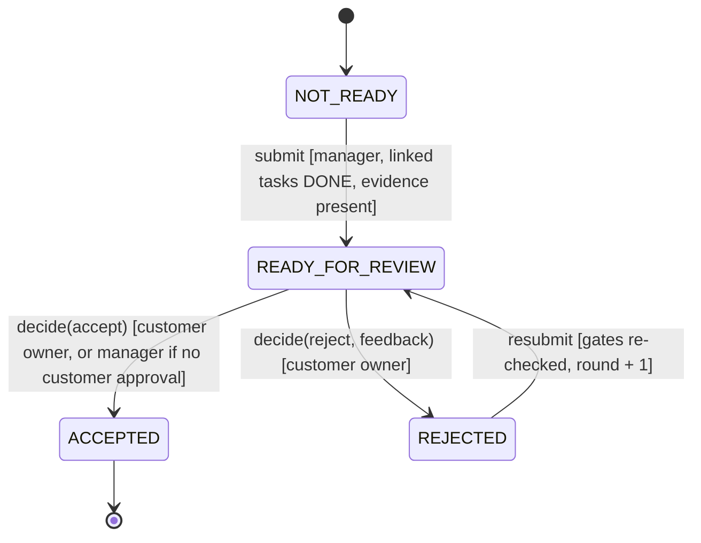

# ADR-0017: Milestone acceptance workflow with evidence

- **Status:** Proposed
- **Date:** 2026-11-20

## Context

FR-05 requires milestones to be submitted only when linked tasks are done and required evidence exists; customer owners accept or reject with feedback; rejection reopens the milestone and preserves history; acceptance history is immutable (L-08, L-09, L-10). Launch gates depend on accepted milestones (L-13).

## Decision Drivers

- Approval integrity
- Complete, immutable review history
- Clear feedback on why submission is blocked

## Considered Options

1. Milestone state machine plus append-only `milestone_reviews` rounds
2. Mutable status with a comment log
3. Generic workflow engine

## Decision Outcome

Chosen option: **state machine with append-only review rounds** (LD-037 to LD-039).

Each submission inserts a `milestone_reviews` row with `round = current_review_round + 1`; a decision fills `decided_by`, `decided_at`, `decision` and `feedback` once and is never updated again (enforced by a trigger and by service code). Submission failures return 422 listing missing tasks and evidence. Milestones without customer approval still record a separate manager acceptance. Submitted and decided events notify the other side (ADR-0012).

## Consequences

### Positive

- Full history for disputes and audits
- Launch gate can rely on `ACCEPTED`

### Negative

- Rows accumulate per round (small)

## Links

- ADR-0008
- ADR-0011
- ADR-0012
