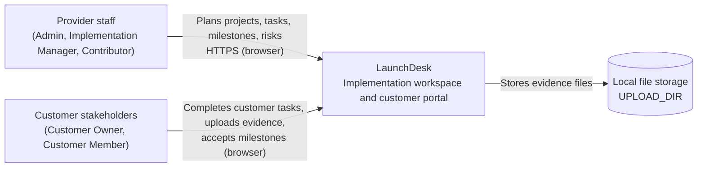
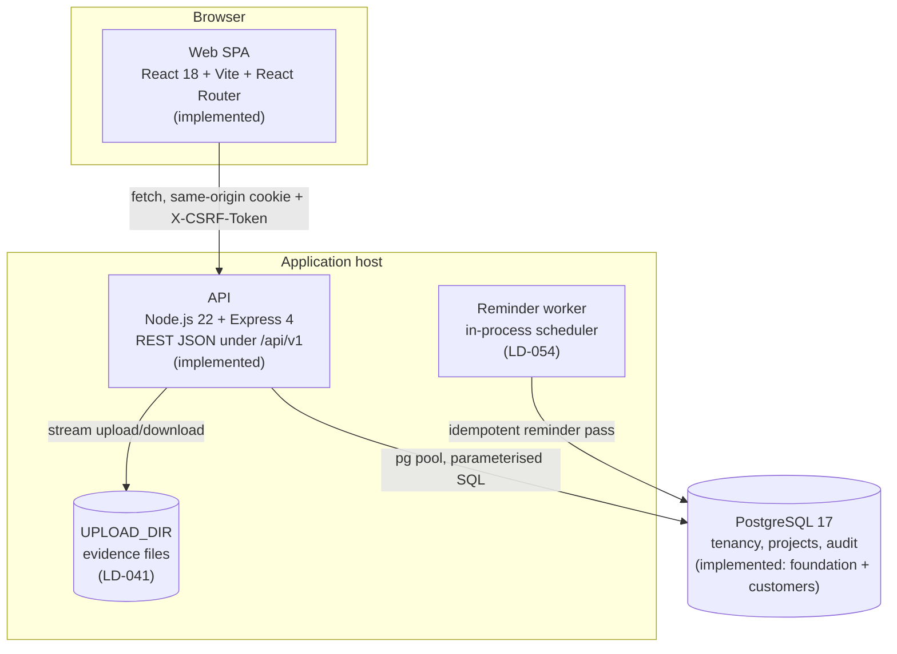
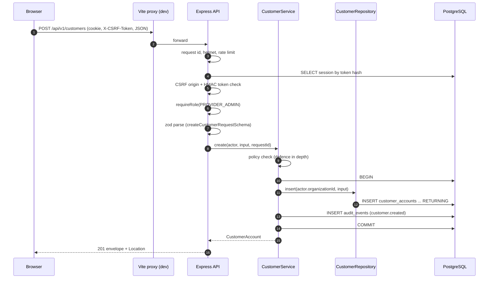

# Architecture overview

LaunchDesk is a modular monolith (ADR-0002): one Express API process, one React single-page app, one
PostgreSQL database. Provider staff and customer stakeholders use the same deployment but see two
separately routed, separately queried experiences (ADR-0013).

**Status legend:** components marked _(implemented)_ exist in the code today; everything else is
designed and tracked by the ticket shown.

## C4 level 1: system context



There are deliberately no external systems: no email, CRM, calendar, payment or identity provider
(PRD §1 "Not included", §2). Notifications are in-app only.

## C4 level 2: containers



In development, Vite serves the SPA on port 5173 and proxies `/api` to the API on port 4103, so
the browser sees a single origin. In production the API serves behind a TLS reverse proxy (see
[deployment](../operations/deployment.md)).

## C4 level 3: API components

```mermaid
flowchart TB
  subgraph mw["HTTP pipeline (implemented)"]
    rid[request-id] --> log[pino-http] --> helm[helmet] --> json[json body 1 MB] --> rl[rate limit]
    rl --> sess[loadSession] --> csrf[csrfProtection]
  end
  csrf --> router["/api/v1 router"]
  router --> auth["auth module<br/>(implemented)"]
  router --> customers["customers module<br/>routes, service, policy, repository<br/>(implemented, LD-008)"]
  router --> pending["pending modules<br/>templates, projects, tasks, milestones,<br/>risks, files, activity, customer-portal,<br/>reports, notifications, audit<br/>(pendingRouter, 501 + ticket)"]
  subgraph domain["Pure domain (implemented)"]
    graph["tasks/domain/dependency-graph<br/>(LD-021)"]
    health["projects/domain/project-health<br/>(LD-020)"]
  end
  pending -. "will use" .-> graph
  pending -. "will use" .-> health
  customers --> auditsvc["audit.service<br/>recordAudit(tx)"]
  customers --> pool[("pg Pool / transaction")]
  auditsvc --> pool
  router --> err["error handler<br/>envelope + request id"]
```

## Module boundaries

| Module            | Responsibility                                                      | Status                                                                       |
| ----------------- | ------------------------------------------------------------------- | ---------------------------------------------------------------------------- |
| `auth`            | Login, logout, session lookup, CSRF token                           | Implemented                                                                  |
| `health`          | Liveness and readiness probes                                       | Implemented                                                                  |
| `audit`           | Append-only `recordAudit` writer; audit history API                 | Writer implemented; API LD-059                                               |
| `customers`       | Customer accounts (FR-01)                                           | List/create/get implemented (LD-008); update/archive LD-011; contacts LD-013 |
| `templates`       | Templates, phases, template tasks, dependencies, milestones (FR-02) | LD-014 to LD-018                                                             |
| `projects`        | Project lifecycle, rebaseline, health and progress (FR-03, FR-09)   | Health rules implemented (LD-020); API LD-022 to LD-028, LD-046              |
| `tasks`           | Tasks, subtasks, dependencies, checklist, comments (FR-04)          | Dependency graph implemented (LD-021); API LD-029 to LD-035                  |
| `milestones`      | Milestones, submission gates, review rounds (FR-05)                 | LD-037 to LD-039                                                             |
| `risks`           | Risk, issue and decision register (FR-06)                           | LD-045                                                                       |
| `files`           | Uploads, versions, authorized downloads (FR-08)                     | LD-041 to LD-043                                                             |
| `activity`        | Project events and decision register (FR-10)                        | LD-053                                                                       |
| `customer-portal` | Customer-only read models and actions (FR-07)                       | LD-051                                                                       |
| `reports`         | Portfolio KPIs and CSV export (FR-09)                               | LD-056, LD-057                                                               |
| `notifications`   | In-app notifications and reminder worker (FR-07)                    | LD-054                                                                       |

Rules: a module reads and writes only its own tables; cross-module needs go through the other
module's service. Domain code under `*/domain/` is pure (no I/O, no clock reads, no mutation) and is
the only place business rules live.

## Request lifecycle



On any error the transaction rolls back and the error handler maps `AppError` codes to the envelope
(unique violation to `409 CONFLICT`, zod failure to `422 VALIDATION_FAILED`, unknown id to `404`).

## Cross-cutting concerns

| Concern             | Approach                                                                 | Status                                                          |
| ------------------- | ------------------------------------------------------------------------ | --------------------------------------------------------------- |
| Tenant isolation    | `organization_id` from session on every query; composite FKs (ADR-0003)  | Implemented for customers                                       |
| Customer visibility | Separate `/customer/*` API tree with SQL-level filtering (ADR-0013)      | Binding implemented; portal LD-051                              |
| Authorization       | Route guards + service policy (ADR-0007)                                 | Implemented                                                     |
| Validation          | zod schemas in `packages/shared`, strict objects                         | Implemented                                                     |
| Audit               | `recordAudit(tx)` in the business transaction (ADR-0008)                 | Implemented                                                     |
| Concurrency         | `version` columns, `409` on stale writes, row locks for dependency edits | Column present on customers; enforcement LD-024, LD-029, LD-030 |
| Time                | UTC timestamps; local dates per project time zone (`local-date.ts`)      | Implemented in domain                                           |
| Errors              | Stable codes, request id, no stack traces to clients                     | Implemented                                                     |
| Observability       | Structured pino logs with redaction, request ids, health probes          | Implemented; metrics planned (deployment plan)                  |
| Pending surface     | `pendingRouter` returns 501 + ticket; `PendingPage` names the ticket     | Implemented                                                     |
