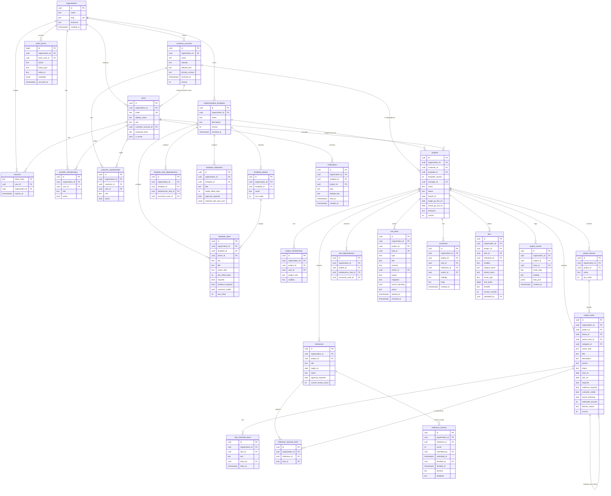

# Data model

Full model from PRD §6, mapped onto the foundation schema. Naming conventions:

- The PRD's `provider_organizations` is the `organizations` table; `provider_org_id` is
  `organization_id` (ADR-0003). Every tenant-owned table carries it.
- Child rows reference parents with composite foreign keys `(organization_id, parent_id)` so a row
  cannot point at another tenant's parent.
- Primary keys are UUIDs (`gen_random_uuid()`), except `audit_events` (bigserial for ordering).

## Entity-relationship diagram

The PRD's `audit_logs` is implemented as `audit_events` (foundation migration, ADR-0008).

## Migration status

| Table                                                                                                                | Migration                              | Status    |
| -------------------------------------------------------------------------------------------------------------------- | -------------------------------------- | --------- |
| `organizations`, `users`, `sessions`, `audit_events`                                                                 | `0001_foundation.sql`                  | ✅ Exists |
| `customer_accounts`; `users.customer_account_id`, role CHECK, customer binding CHECK                                 | `0002_roles_and_customer_accounts.sql` | ✅ Exists |
| `organizations.timezone` (default project time zone)                                                                 | planned `0003`                         | ⏳ LD-022 |
| `provider_memberships`, `customer_memberships`                                                                       | planned                                | ⏳ LD-012 |
| `implementation_templates`, `template_phases`, `template_tasks`, `template_task_dependencies`, `template_milestones` | planned                                | ⏳ LD-014 |
| `projects`, `project_memberships`, `project_phases`, `project_tasks`, `task_dependencies`, `task_checklist_items`    | planned                                | ⏳ LD-022 |
| `milestones`, `milestone_required_tasks`, `milestone_reviews`                                                        | planned                                | ⏳ LD-037 |
| `risk_items`                                                                                                         | planned                                | ⏳ LD-045 |
| `comments`                                                                                                           | planned                                | ⏳ LD-035 |
| `files`                                                                                                              | planned                                | ⏳ LD-042 |
| `project_events`                                                                                                     | planned                                | ⏳ LD-053 |
| `notifications`                                                                                                      | planned                                | ⏳ LD-054 |

## Per-table notes

### Implemented

**organizations** - provider tenant. `slug` unique, lowercase. Tenant key for every other table.

**users** - `email` unique and lowercase. `role` CHECK in the five PRD roles
(`users_role_check`). `users_customer_binding_check`: customer roles require `customer_account_id`,
provider roles forbid it. Composite FK `(organization_id, customer_account_id)` to
`customer_accounts (organization_id, id)` (`users_customer_account_fk`) so a customer user can only be
bound to a customer of their own provider. Partial index on `customer_account_id`.

**sessions** - token hash primary key, `expires_at` index for the sweep.

**audit_events** - append-only. Index `(organization_id, occurred_at DESC)` and `(entity_type, entity_id)`.

**customer_accounts** - columns per FR-01 plus `created_by`, `created_at`, `updated_at`, `version`.
Length CHECKs mirror the zod limits. `UNIQUE (organization_id, id)` is the composite-FK target.
Unique index `(organization_id, lower(name))`; listing index `(organization_id, created_at DESC, id)`;
partial index for active customers. Status is derived: `archived_at IS NULL` means `ACTIVE`.

### Planned (key constraints)

| Table                        | Constraints and indexes                                                                                                                                                                                                                                                                                        |
| ---------------------------- | -------------------------------------------------------------------------------------------------------------------------------------------------------------------------------------------------------------------------------------------------------------------------------------------------------------- |
| `implementation_templates`   | `UNIQUE (organization_id, id)`; `version > 0`                                                                                                                                                                                                                                                                  |
| `template_tasks`             | `UNIQUE (template_id, key)`; `owner_side IN ('PROVIDER','CUSTOMER')`; `due_offset_days >= 0`                                                                                                                                                                                                                   |
| `template_task_dependencies` | `UNIQUE (template_id, predecessor_task_id, successor_task_id)`; `CHECK (predecessor <> successor)`; acyclicity checked in service (ADR-0014)                                                                                                                                                                   |
| `projects`                   | `status` CHECK (7 lifecycle values); FK `(organization_id, customer_id)`; `target_go_live_on >= kickoff_on`; index `(organization_id, status)`, `(customer_id, status)`; `version`                                                                                                                             |
| `project_tasks`              | `UNIQUE (organization_id, project_id, id)` as FK target; FK `(organization_id, project_id)`; `parent_task_id` must reference a top-level task of the same project (trigger); `status` CHECK; index `(organization_id, project_id)`, `(project_id, due_on) WHERE status <> 'DONE'`; `estimated_minutes` integer |
| `task_dependencies`          | FKs `(organization_id, project_id, predecessor_task_id)` and `(..., successor_task_id)` to `project_tasks` (prevents cross-project edges); `UNIQUE (project_id, predecessor_task_id, successor_task_id)`                                                                                                       |
| `milestone_required_tasks`   | FKs through `(organization_id, project_id, task_id)`; unique pair                                                                                                                                                                                                                                              |
| `milestone_reviews`          | `UNIQUE (milestone_id, round)`; decision columns write-once (trigger)                                                                                                                                                                                                                                          |
| `risk_items`                 | `type IN ('RISK','ISSUE','DECISION')`; `severity IN ('LOW','MEDIUM','HIGH','CRITICAL')`; `status IN ('OPEN','IN_PROGRESS','RESOLVED','CLOSED')`; partial index `(project_id) WHERE launch_blocking AND status IN ('OPEN','IN_PROGRESS')`                                                                       |
| `comments`, `project_events` | `visibility IN ('INTERNAL','SHARED')`; index `(project_id, created_at DESC)`                                                                                                                                                                                                                                   |
| `files`                      | `visibility IN ('INTERNAL','SHARED_WITH_CUSTOMER')`; `size_bytes > 0`; exactly one parent among project/task/milestone scope                                                                                                                                                                                   |
| `notifications`              | `UNIQUE (recipient_id, dedupe_key)` for idempotent reminders                                                                                                                                                                                                                                                   |

## Conventions

### Time

- Instants are `timestamptz`, stored and transported in UTC (ISO 8601 with `Z`).
- Calendar dates (`kickoff_on`, `due_on`, `target_on`, go-live dates) are `date` values interpreted in
  the project's IANA `timezone`. "Today" for overdue and health is computed from `now` in that zone
  (`projects/domain/local-date.ts`).

### Numbers and money

- No floating point in the domain. Estimates are stored as integer minutes; ratios (progress,
  overdue share) are integer basis points (1 % = 100 bps).
- LaunchDesk stores no monetary amounts in the MVP (no billing, PRD §1). If pricing or contract value
  is added, amounts use integer minor units plus an ISO 4217 currency code.

### Soft delete

Customer accounts, templates and projects are archived (`archived_at` or a terminal status), never
hard-deleted through the API (FR-10).
