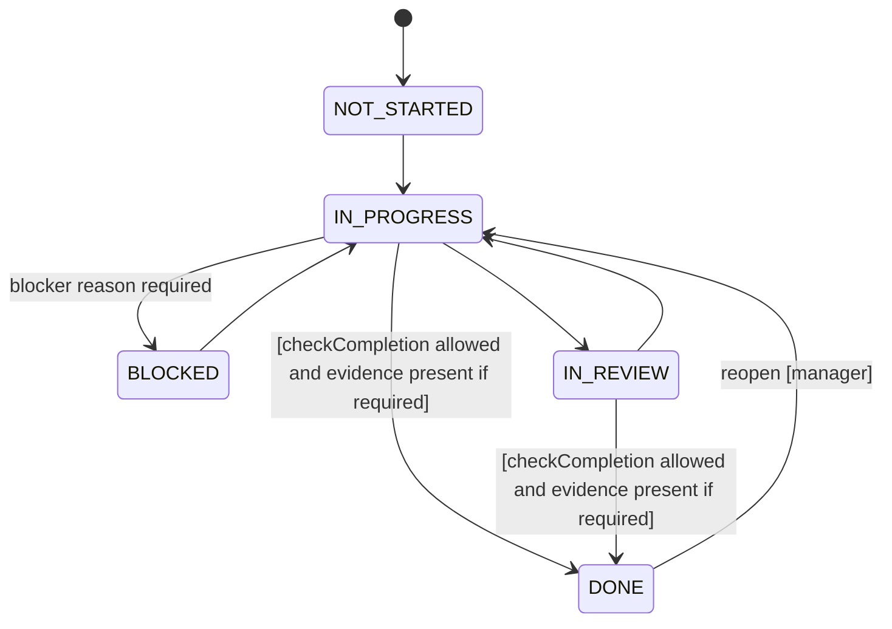
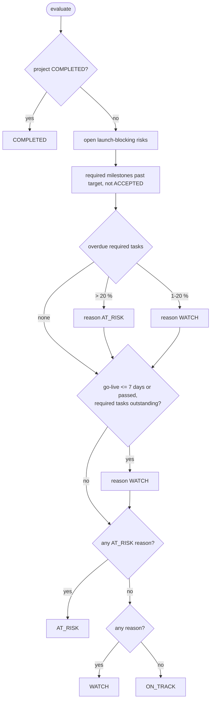

# System design

Module-by-module design for LaunchDesk. Each section states what exists in code now and what the
pending tickets will build. Architecture context is in [overview](../architecture/overview.md);
tables are in the [data model](data-model.md).

## 1. Identity, tenancy and access (implemented)

- **Tenant:** `organizations` row = provider organization. Every tenant-owned row carries
  `organization_id` (ADR-0003).
- **Users:** one role per user (`users.role`, CHECK-constrained to the five PRD roles). Customer roles
  are bound to exactly one `customer_account_id` of the same tenant (ADR-0013).
- **Sessions:** opaque token, SHA-256 hash stored, httpOnly cookie, CSRF HMAC token (ADR-0005).
- **Authorization:** `requireRole` route guards (`modules/guards.ts`) plus service policies.
  Multi-membership and project-level roles are LD-012 and LD-019.

## 2. Customer accounts (implemented: list, create, get)

Responsibilities: maintain the provider's customer accounts (FR-01) and gate project creation for
archived customers (LD-011).

| Layer      | File                                       | Notes                                                                                                                  |
| ---------- | ------------------------------------------ | ---------------------------------------------------------------------------------------------------------------------- |
| Schema     | `packages/shared/src/schemas/customers.ts` | Strict zod objects; blank optional text becomes `null`; unknown fields (e.g. a smuggled `organizationId`) are rejected |
| Routes     | `customers.routes.ts`                      | `GET /`, `POST /`, `GET /:id`; malformed ids answer 404                                                                |
| Policy     | `customers.policy.ts`                      | Read: provider roles. Create: Provider Admin                                                                           |
| Service    | `customers.service.ts`                     | Policy re-check, transaction, audit, unique violation to 409                                                           |
| Repository | `customers.repository.ts`                  | Tenant id first parameter on every query; LIKE escaping for search                                                     |

Pending: `PATCH /customers/:id` with optimistic locking and archive/unarchive (LD-011); contacts
(LD-013).

## 3. Templates (LD-014 to LD-018)

A template holds phases, tasks (key, owner side `PROVIDER|CUSTOMER`, `due_offset_days`, required,
evidence required, customer visible), dependencies and milestones with required task keys.

- Every save validates the dependency graph with the pure module (ADR-0014); `POST /templates/:id/validate`
  exposes the same check and returns the cycle path on failure.
- Each update increments `version`. Duplicate copies all child rows with new ids in one transaction.
- Templates are archived, never deleted, so projects can reference their source.

## 4. Projects and lifecycle (LD-022 to LD-028, LD-036)

### Creation by snapshot (ADR-0015)

```mermaid
sequenceDiagram
  autonumber
  participant M as Manager
  participant API as ProjectService
  participant G as dependency-graph (pure)
  participant D as PostgreSQL
  M->>API: POST /projects {customerId, templateId, managerId, kickoffOn, targetGoLiveOn, timezone}
  API->>D: BEGIN; load template + children; check customer not archived
  API->>API: compute due dates = kickoff + offset (project time zone)
  API->>G: createDependencyGraph(new task ids, re-keyed edges)
  G-->>API: ok (acyclic) or CYCLE
  API->>D: INSERT project, phases, tasks, dependencies, milestones, required tasks
  API->>D: INSERT project_events (project.created), audit_events
  API->>D: COMMIT
  API-->>M: 201 project
```

### Lifecycle state machine

```mermaid
stateDiagram-v2
  [*] --> DRAFT
  DRAFT --> ACTIVE: activate [manager]
  ACTIVE --> READY_FOR_LAUNCH: ready [all launch-blocking tasks DONE and required milestones ACCEPTED and no open launch-blocking risk]
  READY_FOR_LAUNCH --> ACTIVE: reopen [manager, reason]
  READY_FOR_LAUNCH --> LIVE: go live [manager confirms; records actual_go_live_on + decision]
  LIVE --> COMPLETED: complete [manager]
  DRAFT --> CANCELLED: cancel [reason]
  ACTIVE --> ON_HOLD: hold [reason]
  ON_HOLD --> ACTIVE: resume [reason]
  ACTIVE --> CANCELLED: cancel [reason]
  ON_HOLD --> CANCELLED: cancel [reason]
  COMPLETED --> [*]
  CANCELLED --> [*]
```



Illegal transitions return `409 INVALID_STATE_TRANSITION`; unmet launch gates return `422` with
the list of blocking tasks, milestones and risks (L-13). Every transition writes a project event
and an audit row; `LIVE` also writes a decision-register entry (L-14).

### Rebaseline (L-17)

Changing `target_go_live_on` never moves task dates. `POST /projects/:id/rebaseline` with
`{shiftDays | newKickoffOn, confirm: false}` returns a preview of every changed due date; the same
call with `confirm: true` and the preview's `version` applies it atomically and records an audit
entry with old and new dates.

## 5. Tasks and dependencies (domain implemented; API LD-029 to LD-035)

### Dependency graph (implemented, ADR-0014)

`apps/api/src/modules/tasks/domain/dependency-graph.ts` is a pure, immutable module:

| Function                                         | Behaviour                                                                                                                                   |
| ------------------------------------------------ | ------------------------------------------------------------------------------------------------------------------------------------------- |
| `createDependencyGraph(projectId, tasks, edges)` | Validates tasks (duplicates, cross-project) and replays edges through `addDependency`                                                       |
| `addDependency(graph, edge, external?)`          | Rejects `SELF_DEPENDENCY`, `UNKNOWN_TASK`, `CROSS_PROJECT_TASK`, `DUPLICATE_DEPENDENCY`, `CYCLE` (with path); otherwise returns a new graph |
| `removeDependency`                               | New graph without the edge (same instance if absent)                                                                                        |
| `topologicalOrder`                               | Kahn's algorithm, ties in task insertion order                                                                                              |
| `taskReadiness` / `deriveReadiness`              | `READY`, `BLOCKED` (with incomplete predecessors) or `DONE`                                                                                 |
| `withTaskStatus`                                 | New graph with one task's status changed                                                                                                    |
| `checkCompletion(graph, id, override?)`          | DONE gate; a non-blank override reason allows completion                                                                                    |

Persistence flow for `POST /tasks/:id/dependencies` (LD-030):

```mermaid
sequenceDiagram
  participant C as Client
  participant S as TaskService
  participant D as PostgreSQL
  participant G as dependency-graph
  C->>S: add predecessor P to task T
  S->>D: BEGIN; SELECT project FOR UPDATE (tenant-scoped)
  S->>D: load tasks + edges of project
  S->>G: createDependencyGraph(...) then addDependency(P -> T)
  alt rejected
    G-->>S: CYCLE [P, T, ..., P]
    S-->>C: 422 VALIDATION_FAILED {code: CYCLE, cycle}
  else accepted
    S->>D: INSERT task_dependencies; audit; COMMIT
    S-->>C: 201
  end
```

### Task status machine



A manager override of the predecessor gate stores the reason on the transition event and in the
audit log (L-05). Overdue = required/any task not DONE with `due_on` before today in the project
time zone (`local-date.ts`).

## 6. Milestones and acceptance (LD-037 to LD-040, LD-044)

State machine and review rounds are defined in ADR-0017. Submission gate: all linked required tasks
`DONE` and, for tasks with `evidence_required`, at least one current file. The 422 response lists
`missingTasks[]` and `missingEvidence[]` (L-08). Decisions are append-only; rejection requires
feedback and a resubmission creates round `n + 1` (L-09, L-10).

## 7. Risks and project health (domain implemented; API LD-045, LD-046)

### Health rules (implemented, ADR-0016)

`evaluateProjectHealth(input, { now, timezone })` returns `{ status, reasons[], evaluatedOn, metrics }`.



LD-046 loads inputs with three tenant-scoped queries (tasks, milestones, risks) and computes health
on read; portfolio views batch the queries by project id. Progress =
`completed_required_tasks / total_required_tasks`, reported as basis points; zero required tasks
reports 0 % progress and excludes the project from progress averages.

### Risk items

Fields per PRD FR-06. Only items with `launch_blocking = true` and status `OPEN`/`IN_PROGRESS` affect
health and launch gates. Open age = today - `opened_at` (project time zone).

## 8. Files and evidence (LD-041 to LD-043, ADR-0011)

Upload: stream to a temp file, check size and MIME/extension allow-list (PDF, PNG, JPEG, CSV, XLSX,
DOCX, TXT), compute SHA-256, move to `UPLOAD_DIR/<org>/<random>`, insert metadata. A re-upload of the
same logical deliverable inserts a new row with `version_number + 1`. Download: tenant + project +
visibility check, then stream with `Content-Disposition: attachment`. Customers can download only
`SHARED_WITH_CUSTOMER` files of their own projects; anything else is 404.

## 9. Customer portal (LD-051, LD-052, ADR-0013)

Dedicated read models: every query joins `projects.customer_id = session.customerAccountId` and
filters `customer_visible = true` / `visibility = 'SHARED'` in SQL. Response DTOs are separate types
with no internal fields, so a provider-only property cannot be serialised by accident.

## 10. Background jobs and notifications (LD-054, ADR-0012)

| Job                         | Interval | Idempotency                                           |
| --------------------------- | -------- | ----------------------------------------------------- |
| Session sweep (implemented) | 15 min   | Delete where `expires_at <= now()`                    |
| Due/overdue reminders       | 10 min   | Unique `(recipient_id, type, subject_id, local_date)` |
| Notification purge          | daily    | Delete older than 12 months                           |

Event-driven notifications (assignment, approval requested, milestone rejected, deadline changed)
are inserted in the same transaction as the triggering change.

## 11. Concurrency and idempotency

- Optimistic locking: `projects.version`, `project_tasks.version`, `customer_accounts.version`.
  Updates use `WHERE id = $1 AND version = $2` and return `409 CONFLICT` when no row matches.
- Pessimistic locking only for dependency changes and project transitions (`SELECT ... FOR UPDATE`
  on the project row).
- Unique constraints: customer name per tenant (case-insensitive, implemented), template task key per
  template, dependency pair per project, review round per milestone.
- Creation endpoints are not idempotent by key in the MVP; duplicates are prevented by unique
  constraints where meaningful.

## 12. Error handling

All errors use the envelope (ADR-0006). Mapping: zod failure to 422 with `details[{path, message}]`;
domain rule failure to 422 with a structured `details.code`; unique violation to 409; stale version
to 409; foreign or unknown ids to 404; role failures to 403; unhandled errors to 500 with a generic
message (stack traces only in server logs, keyed by request id).

## 13. Performance and indexing

| Index                                                                  | Purpose                              | Status      |
| ---------------------------------------------------------------------- | ------------------------------------ | ----------- |
| `customer_accounts (organization_id, lower(name))` unique              | Duplicate prevention and name lookup | Implemented |
| `customer_accounts (organization_id, created_at DESC, id)`             | Tenant listing                       | Implemented |
| `customer_accounts (organization_id) WHERE archived_at IS NULL`        | Active customer pickers              | Implemented |
| `projects (organization_id, status)`, `projects (customer_id, status)` | Portfolio and portal                 | LD-022      |
| `project_tasks (organization_id, project_id)`, `(project_id, due_on)`  | Task lists, overdue scans            | LD-022      |
| `task_dependencies (project_id, successor_task_id)`                    | Graph loading                        | LD-022      |
| `audit_events (organization_id, occurred_at DESC)`                     | Audit history                        | Implemented |

Pagination is mandatory on collections (max 100 per page).

## Future scaling path

1. Read replicas for reporting queries (LD-056) once portfolio queries exceed their p95 target.
2. Materialised per-project health snapshot refreshed on write if computing on read becomes costly.
3. Object storage for files and multiple API instances behind a load balancer (sessions already shared).
4. PostgreSQL row-level security as a second isolation layer.
5. Extract reporting into a separate read service only if load profiles diverge significantly.
