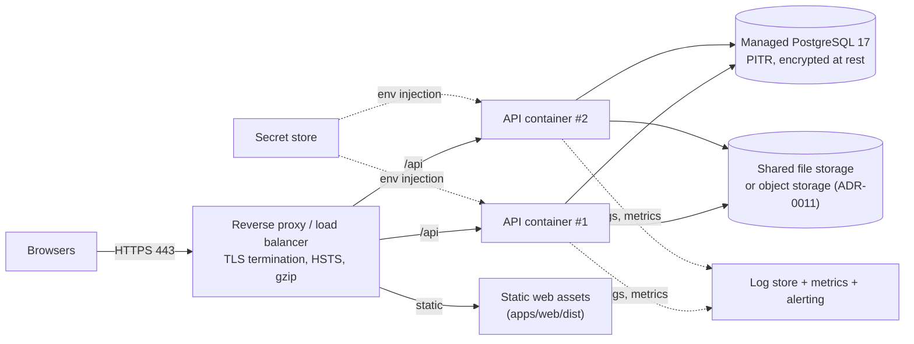

# Deployment (plan)

> **Status: plan.** Nothing in this document is deployed today. LaunchDesk currently runs locally
> through `./run.sh`. Production delivery is tracked by LD-065. The plan respects the PRD constraint
> that the product itself has no third-party runtime dependencies.

## Target topology

## Container image

- Multi-stage build: `node:22-alpine` builder runs `npm ci` and `npm run build`; runtime stage
  copies `apps/api/dist`, `apps/api/migrations`, production `node_modules` and the web `dist`.
- Runs as a non-root user, read-only root filesystem, writable volume only for `UPLOAD_DIR`.
- `HEALTHCHECK` calls `/api/health/live`; orchestrator readiness uses `/api/health/ready`.
- Image tagged with the git SHA; SBOM generated and scanned in CI.

## Reverse proxy and TLS

- TLS 1.2+ only, certificates managed by the platform; HSTS (already sent by helmet).
- Proxy forwards `X-Forwarded-For`; the API trusts only the proxy hop (`trust proxy` configured per
  environment) so rate limiting sees client IPs.
- `APP_ORIGIN` set to the public HTTPS origin; cookies become `Secure` automatically in production.

## Database

- Managed PostgreSQL 17 with automated backups, point-in-time recovery (RPO 15 min) and encryption at rest.
- Separate database roles: migration role (DDL) and application role (DML only, no UPDATE/DELETE on
  `audit_events`).
- Connection pool sized per instance (`DATABASE_POOL_MAX`), total below the server limit.

## Secrets and configuration

- All configuration via environment variables (ADR-0009), injected from the platform secret store.
- `SESSION_SECRET` is 64 random hex characters per environment, rotated quarterly (rotation logs
  everyone out; acceptable for this product).
- The development seed and reset commands refuse to run with `NODE_ENV=production`.

## Migrations in CD

1. CI builds and tests the image (lint, typecheck, unit, integration, E2E).
2. CD runs `node dist/cli.js migrate` as a one-off job with the migration role **before** rolling out
   new API instances.
3. Migrations are forward-only and must be backward compatible with the previous release
   (expand/contract: add nullable column, deploy code, backfill, then tighten constraints in a later
   release).

## Zero-downtime rollout

- Rolling update with at least two instances; new instances receive traffic only after readiness
  passes; old instances drain via SIGTERM (graceful shutdown already implemented, 10 s timeout).
- Sessions live in PostgreSQL, so no sticky sessions are needed.
- Rollback: redeploy the previous image; schema is compatible by the expand/contract rule.

## Observability stack

| Signal  | Plan                                                                                                                      |
| ------- | ------------------------------------------------------------------------------------------------------------------------- |
| Logs    | JSON stdout shipped to a central log store; retention 30 days; search by `req.id`                                         |
| Metrics | `/metrics` (Prometheus format): request rate, latency histograms per route, error rate, pool usage, reminder job duration |
| Alerts  | 5xx rate > 1 % for 5 min; p95 latency > 2x target for 10 min; readiness failing; disk usage of file storage > 80 %        |
| Tracing | Optional OpenTelemetry instrumentation when the platform provides a collector                                             |
| Audit   | `audit_events` exported nightly to write-once storage                                                                     |

## Pre-production checklist

- [ ] LD-063 isolation regression suite green
- [ ] LD-061 / LD-062 acceptance suites green
- [ ] File upload hardening (LD-041) reviewed
- [ ] Backup restore drill performed
- [ ] Security review against the [threat model](../security/threat-model.md)
