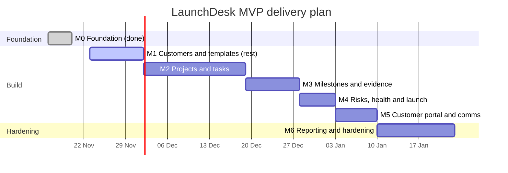

# Roadmap

Phased delivery of the LaunchDesk MVP. Estimates are focused engineering hours from the
[backlog](backlog.md) (65 tickets, 250 h total). Completed work: 39 h (15.6 %).

| Milestone                              | Goal                                                                 | Exit criteria                                                                                                                      | Tickets          |         Estimate | Status         |
| -------------------------------------- | -------------------------------------------------------------------- | ---------------------------------------------------------------------------------------------------------------------------------- | ---------------- | ---------------: | -------------- |
| M0: Foundation                         | Runnable, secure skeleton with docs                                  | `./run.sh` works from a fresh clone; CI green; auth, CSRF, audit, health; actor model in DB; ADRs                                  | LD-001 to LD-007 |             23 h | ✅ Done        |
| M1: Customers and templates            | Provider can manage customers and templates; core domain rules exist | Customer accounts CRUD with archive and contacts; templates CRUD/duplicate/validate; dependency graph and health rules unit-tested | LD-008 to LD-021 | 49 h (16 h done) | ⏳ In progress |
| M2: Projects and tasks                 | Managers run projects from templates                                 | Snapshot creation (L-02, L-03); lifecycle; tasks with dependency gate (L-04, L-05); rebaseline (L-17)                              | LD-022 to LD-036 |             59 h | ⏳ Pending     |
| M3: Milestones and evidence            | Approval integrity                                                   | Milestone gates and review rounds (L-08 to L-10); evidence upload and authorized download (L-07, L-18)                             | LD-037 to LD-044 |             30 h | ⏳ Pending     |
| M4: Risks, health and launch           | Trustworthy status and controlled go-live                            | Risk register; health from SQL (L-11, L-12); launch gates (L-13, L-14); portfolio dashboard (L-01)                                 | LD-045 to LD-050 |             21 h | ⏳ Pending     |
| M5: Customer portal and communications | Customers act without seeing internal data                           | Customer portal (L-06, L-15); activity timeline; in-app notifications                                                              | LD-051 to LD-055 |             22 h | ⏳ Pending     |
| M6: Reporting and hardening            | Production readiness                                                 | Reports and CSV (L-19); audit screen; demo dataset; L-01..L-19 green; isolation suite; accessibility; deployment pipeline          | LD-056 to LD-065 |             46 h | ⏳ Pending     |

M1 completed so far: customer accounts list/create/get with screen and seed (LD-008 to LD-010),
dependency graph domain (LD-021) and project health rules (LD-020).

## Schedule

Assumes one engineer at roughly 25 focused hours per week, starting 2026-11-23.

## Scope guardrails

If the schedule slips, cut in this order (PRD §10): Kanban drag-and-drop (LD-033), advanced reporting
charts (LD-058), notification work queue (LD-055). Never cut customer isolation (LD-051, LD-063),
evidence access control (LD-042) or approval integrity (LD-038, LD-039).

## Beyond the MVP (PRD §12)

CRM import/sync, email and calendar scheduling, external notifications, customer branding,
change-request workflows, billing and contract linkage, resource planning, template marketplace,
customer self-registration and rule-based onboarding suggestions. None are planned in this backlog.
