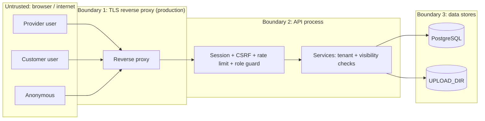

# Threat model

Scope: the LaunchDesk API, web client, database and local file storage. Method: STRIDE per
component, reviewed whenever a module moves from pending to implemented. Status values:
**Implemented** (in code and tested) or **Pending** (ticket shown).

## Assets

| Asset                                           | Why it matters                                                            |
| ----------------------------------------------- | ------------------------------------------------------------------------- |
| Customer account and project data per provider  | Confidential commercial information; cross-tenant leakage is the top risk |
| Provider-internal tasks, comments, files, risks | Must never reach customer users (PRD §3, FR-07)                           |
| Evidence files                                  | May contain customer data samples (e.g. migration CSVs)                   |
| Milestone approvals and launch decisions        | Contractual significance; must be tamper-evident                          |
| Credentials and sessions                        | Account takeover                                                          |
| Audit trail                                     | Accountability and dispute resolution                                     |

## Actors

| Actor                                                        | Trust                                                                    |
| ------------------------------------------------------------ | ------------------------------------------------------------------------ |
| Provider Admin, Implementation Manager, Provider Contributor | Authenticated, trusted within their tenant and role                      |
| Customer Owner, Customer Member                              | Authenticated, trusted only for their own customer account's shared data |
| Anonymous internet user                                      | Untrusted                                                                |
| Malicious authenticated user (any role)                      | Tries id guessing, role escalation, cross-tenant access                  |
| Operator with host access                                    | Trusted; protected against by backups and audit, not by the app          |

## Trust boundaries

## STRIDE analysis

### Authentication and sessions

| Threat                               | Mitigation                                                                            | Status      |
| ------------------------------------ | ------------------------------------------------------------------------------------- | ----------- |
| S: credential stuffing / brute force | Login rate limit (10/min/IP), generic 401, constant-time hash compare with dummy hash | Implemented |
| S: session theft via XSS             | httpOnly cookie; React escaping; CSP via helmet                                       | Implemented |
| T: session fixation                  | New random token on every login                                                       | Implemented |
| R: deny having logged in             | `auth.login` audit event with request id                                              | Implemented |
| I: user enumeration by timing        | Dummy hash comparison for unknown emails                                              | Implemented |
| E: stale sessions after role change  | Sessions re-resolve role on every request from `users`                                | Implemented |

### Authorization and tenancy (all modules)

| Threat                                            | Mitigation                                                                                          | Status                                                |
| ------------------------------------------------- | --------------------------------------------------------------------------------------------------- | ----------------------------------------------------- |
| I: cross-tenant read by id guessing (L-16)        | Tenant id from session in every query; foreign ids return 404                                       | Implemented for customers; pending modules LD-063     |
| T: cross-tenant reference on write                | Composite FKs `(organization_id, id)`; strict zod rejects client-supplied tenant ids                | Implemented for users/customers                       |
| I: customer sees other customers (L-15)           | Customer roles cannot call provider endpoints (403); portal queries filter by `customer_account_id` | Route guard implemented; portal LD-051                |
| I: customer sees provider-only task by URL (L-06) | Separate customer DTOs; SQL filter `customer_visible = true`; 404 otherwise                         | Pending LD-051                                        |
| E: contributor performs manager actions           | Route guards + service policy                                                                       | Implemented (customers), guards on all pending routes |
| E: customer member approves milestone             | Only `CUSTOMER_OWNER` (or manager for internal milestones) may decide                               | Guard implemented; logic LD-039                       |

### Customers module (implemented)

| Threat                      | Mitigation                                           | Status      |
| --------------------------- | ---------------------------------------------------- | ----------- |
| T: SQL injection via search | Parameterised queries; LIKE metacharacters escaped   | Implemented |
| D: unbounded list           | Pagination max 100                                   | Implemented |
| I: existence probing        | Unknown and foreign ids both 404, malformed ids 404  | Implemented |
| R: unattributed creation    | `customer.created` audit row in the same transaction | Implemented |

### Templates, projects, tasks, milestones (pending)

| Threat                                     | Mitigation                                                              | Status                         |
| ------------------------------------------ | ----------------------------------------------------------------------- | ------------------------------ |
| T: lost updates                            | Optimistic `version`, 409 on mismatch                                   | Pending LD-024, LD-029         |
| T: cycle via concurrent dependency inserts | Project row lock + pure graph check                                     | Pending LD-030                 |
| T: bypass dependency gate                  | Server-side `checkCompletion`; override needs manager + reason, audited | Domain implemented; API LD-031 |
| T: forged or edited approvals              | Append-only review rounds, write-once decision columns                  | Pending LD-039                 |
| E: go-live via direct API call (L-13)      | Launch gates evaluated server-side in the transition endpoint           | Pending LD-048                 |

### Files (pending, ADR-0011)

| Threat                       | Mitigation                                                                                    | Status         |
| ---------------------------- | --------------------------------------------------------------------------------------------- | -------------- |
| T: malicious upload executed | Stored outside web root under random names; never executed; served as attachment with nosniff | Pending LD-041 |
| D: disk exhaustion           | Size limit, per-request streaming, allow-list                                                 | Pending LD-041 |
| I: unauthorized download     | Tenant + project + visibility check on every download                                         | Pending LD-042 |
| T: path traversal            | Stored name generated server-side; original name used only in Content-Disposition (sanitised) | Pending LD-041 |
| I: malware distribution      | No scanning in MVP; UI caveat; scanning listed as risk R-07                                   | Pending        |

### Reports and export (pending)

| Threat                         | Mitigation                                    | Status         |
| ------------------------------ | --------------------------------------------- | -------------- |
| I: export beyond authorization | Export reuses the authorized list query       | Pending LD-057 |
| T: CSV formula injection       | Prefix cells starting with `= + - @` with `'` | Pending LD-057 |

### Platform

| Threat                     | Mitigation                                       | Status         |
| -------------------------- | ------------------------------------------------ | -------------- |
| CSRF                       | SameSite=Lax, Origin check, HMAC token           | Implemented    |
| Clickjacking               | `X-Frame-Options: SAMEORIGIN` via helmet         | Implemented    |
| Secrets in repo            | `.env` untracked, gitleaks in CI                 | Implemented    |
| Verbose errors             | Generic 500 message, request id for correlation  | Implemented    |
| Log leakage                | pino redaction of cookies, CSRF token, passwords | Implemented    |
| Dependency vulnerabilities | `npm audit` in CI and Dependabot                 | Pending LD-065 |

## OWASP ASVS L2 highlights

| ASVS area   | Requirement (summary)                                           | Status                                    |
| ----------- | --------------------------------------------------------------- | ----------------------------------------- |
| V2.1 / V2.4 | Password storage with a memory-hard KDF (scrypt)                | Implemented                               |
| V2.2        | Anti-automation on authentication                               | Implemented (rate limit)                  |
| V3.2 / V3.4 | Session tokens random, httpOnly, SameSite, Secure in production | Implemented                               |
| V3.3        | Logout invalidates server-side session                          | Implemented                               |
| V4.1        | Access control enforced server-side, deny by default            | Implemented (guards on every route)       |
| V4.2        | Object-level authorization (IDOR)                               | Implemented for customers; LD-051, LD-063 |
| V5.1        | Input validation with allow-lists (zod strict)                  | Implemented                               |
| V5.3        | Output encoding / injection prevention (parameterised SQL)      | Implemented                               |
| V7.1        | No sensitive data in logs                                       | Implemented                               |
| V8.3        | Sensitive data not cached / leaked in responses                 | Partially; customer DTOs LD-051           |
| V12.1-12.5  | File upload restrictions and safe serving                       | Pending LD-041, LD-042                    |
| V13.2       | RESTful CSRF protection                                         | Implemented                               |
| V14.4       | Security headers                                                | Implemented (helmet)                      |

## Tenant-isolation test plan

| #   | Scenario                                                | Expected                         | Test                                 | Status |
| --- | ------------------------------------------------------- | -------------------------------- | ------------------------------------ | ------ |
| T1  | Org B admin GETs Org A customer by id                   | 404, body contains no Org A data | `apps/api/test/customers.db.test.ts` | ✅     |
| T2  | Org B list shows only Org B customers                   | Only own rows                    | `customers.db.test.ts`               | ✅     |
| T3  | Customer owner/member lists customer accounts           | 403, no names leaked             | `customers.db.test.ts`               | ✅     |
| T4  | Bind a user to another tenant's customer account in SQL | FK violation                     | `integration.db.test.ts`             | ✅     |
| T5  | Client sends `organizationId` in body                   | 422                              | `customers.db.test.ts`               | ✅     |
| T6  | Customer roles call provider pending routes             | 403 before handler               | `pending-routes.http.test.ts`        | ✅     |
| T7  | Org B queries Org A project, tasks, files (L-16)        | 404                              | LD-063                               | ⏳     |
| T8  | Customer A queries Customer B project (L-15)            | 404, no metadata                 | LD-051, LD-063                       | ⏳     |
| T9  | Customer member opens provider-only task by URL (L-06)  | 404                              | LD-051                               | ⏳     |
| T10 | Customer downloads internal file                        | 404                              | LD-042                               | ⏳     |
| T11 | Iterate every registered route as foreign tenant        | 401/403/404 only                 | LD-063                               | ⏳     |
