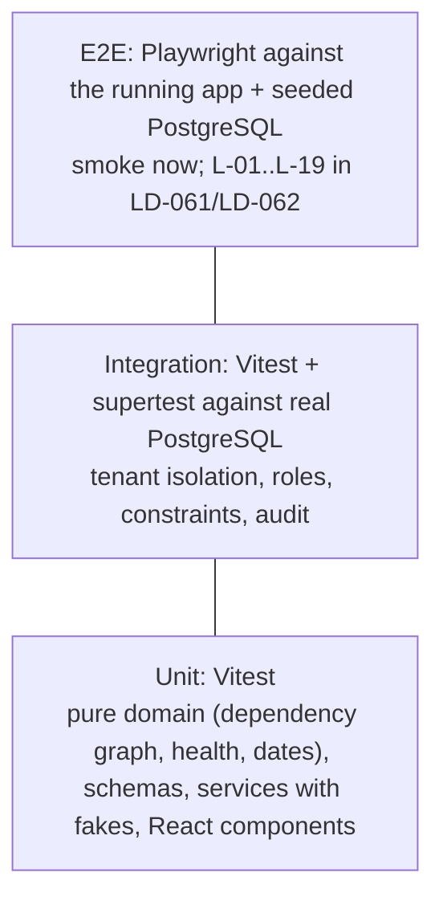

# Test strategy

Decision record: ADR-0010. The goal is to prove every authorization boundary and every business
rule with automated tests before UI polish (PRD closing brief).

## Pyramid

| Layer                | Tools                            | Location                              | Runs in                                                     |
| -------------------- | -------------------------------- | ------------------------------------- | ----------------------------------------------------------- |
| Unit (API)           | Vitest                           | `apps/api/test/*.test.ts` (no `.db.`) | `./run.sh test`, CI                                         |
| Unit (shared)        | Vitest                           | `packages/shared/test`                | `./run.sh test`, CI                                         |
| Unit/component (web) | Vitest + Testing Library + jsdom | `apps/web/test`                       | `./run.sh test`, CI                                         |
| HTTP (no DB)         | supertest with fake pool         | `apps/api/test/*.http.test.ts`        | `./run.sh test`, CI                                         |
| Integration          | supertest + real PostgreSQL      | `apps/api/test/*.db.test.ts`          | `./run.sh test` (creates `<db>_test`), CI service container |
| E2E                  | Playwright (Chromium)            | `e2e/tests`                           | `./run.sh e2e`                                              |

## Current suite

| File                          | Covers                                                                                                                                              | Tests |
| ----------------------------- | --------------------------------------------------------------------------------------------------------------------------------------------------- | ----- |
| `dependency-graph.test.ts`    | Cycle detection with path, self/duplicate/unknown/cross-project rejection, immutability, topological order, readiness, completion gate and override | 29    |
| `project-health.test.ts`      | Every FR-09 rule, 20 % boundary, zero rule, time zone handling, determinism, input validation                                                       | 22    |
| `local-date.test.ts`          | Local date in zone, day numbers, DST-safe day differences                                                                                           | 5     |
| `customers.db.test.ts`        | Customer accounts slice: list/search/paginate, create + audit, 409, 422, CSRF, 403 per role, 404 cross-tenant                                       | 19    |
| `customers.service.test.ts`   | Policy, tenant scoping, transaction rollback on audit failure, 409 mapping                                                                          | 8     |
| `pending-routes.http.test.ts` | Sample of pending routes return 501 + ticket; role guards return 403; anonymous 401                                                                 | 21    |
| `integration.db.test.ts`      | Auth flow, migrations idempotent, role CHECK, customer binding CHECK, cross-tenant FK                                                               | 6     |
| Foundation tests              | Auth service, tokens, password, env, health, envelope                                                                                               | 26    |
| Shared                        | Login, pagination, roles, customer schemas                                                                                                          | 15    |
| Web                           | API client, navigation, PendingPage, CustomersPage                                                                                                  | 19    |
| E2E smoke                     | Login, invalid login, customers list, pending ticket screen, customer navigation                                                                    | 5     |

## Coverage gates

- Global: >= 80 % lines and branches (`npm run test:coverage`, enforced in review; CI runs coverage).
- Pure domain modules (`*/domain/*.ts`): 100 % branch coverage. Current: 100 % for
  `dependency-graph.ts`, `graph-search.ts`, `project-health.ts`, `health-rules.ts`, `local-date.ts`.
- Every new endpoint: at least one 403 test, one cross-tenant 404 test and one 422 test.

## Test data strategy

- Integration tests drop and recreate the `public` schema of a disposable database, run migrations
  and the development seed (`test/db-helpers.ts`). Database files run serially (`fileParallelism: false`).
- Seed fixtures: Northstar Cloud (3 customers, 5 users, one per role) and Meridian Implementations
  (2 customers, 1 admin). Tests create extra rows with unique names.
- Unit tests build inputs with small factory functions; no shared mutable fixtures.
- E2E uses the same development seed; LD-060 adds the deterministic full demo dataset and a reset
  step before the acceptance suite.
- The clock is always injected (`now` parameter) so date-based rules are deterministic.

## PRD §9 acceptance tests

| ID   | Journey                                     | Planned spec                                | Supporting unit/integration                          | Status    |
| ---- | ------------------------------------------- | ------------------------------------------- | ---------------------------------------------------- | --------- |
| L-01 | Admin views portfolio                       | `e2e/tests/l01-portfolio.spec.ts`           | LD-049                                               | ⏳ LD-061 |
| L-02 | Project from template snapshots             | `e2e/tests/l02-create-project.spec.ts`      | LD-023                                               | ⏳ LD-061 |
| L-03 | Template change leaves project unchanged    | `e2e/tests/l03-template-snapshot.spec.ts`   | LD-023                                               | ⏳ LD-061 |
| L-04 | Cyclic dependency rejected                  | `e2e/tests/l04-cycle.spec.ts`               | `dependency-graph.test.ts` ✅                        | ⏳ LD-061 |
| L-05 | Completion blocked by predecessor           | `e2e/tests/l05-dependency-gate.spec.ts`     | `dependency-graph.test.ts` (`checkCompletion`) ✅    | ⏳ LD-061 |
| L-06 | Customer opens provider-only task by URL    | `e2e/tests/l06-customer-direct-url.spec.ts` | LD-051                                               | ⏳ LD-061 |
| L-07 | Customer uploads evidence                   | `e2e/tests/l07-evidence-upload.spec.ts`     | LD-042                                               | ⏳ LD-061 |
| L-08 | Incomplete milestone submission rejected    | `e2e/tests/l08-milestone-gate.spec.ts`      | LD-038                                               | ⏳ LD-061 |
| L-09 | Customer rejects milestone                  | `e2e/tests/l09-milestone-reject.spec.ts`    | LD-039                                               | ⏳ LD-061 |
| L-10 | Customer accepts resubmission               | `e2e/tests/l10-milestone-accept.spec.ts`    | LD-039                                               | ⏳ LD-061 |
| L-11 | Blocking risk makes project AT_RISK         | `e2e/tests/l11-health-risk.spec.ts`         | `project-health.test.ts` ✅                          | ⏳ LD-062 |
| L-12 | Health recalculates after resolution        | `e2e/tests/l12-health-recalc.spec.ts`       | `project-health.test.ts` ✅                          | ⏳ LD-062 |
| L-13 | Go-live before gates denied                 | `e2e/tests/l13-launch-denied.spec.ts`       | LD-048                                               | ⏳ LD-062 |
| L-14 | Authorized go-live persists                 | `e2e/tests/l14-go-live.spec.ts`             | LD-048                                               | ⏳ LD-062 |
| L-15 | Customer queries another customer's project | `e2e/tests/l15-customer-isolation.spec.ts`  | `customers.db.test.ts` (403 on list) ✅, LD-063      | ⏳ LD-062 |
| L-16 | Org B queries Org A project                 | `e2e/tests/l16-tenant-isolation.spec.ts`    | `customers.db.test.ts` (404 cross-tenant) ✅, LD-063 | ⏳ LD-062 |
| L-17 | Rebaseline preview, confirm, audit          | `e2e/tests/l17-rebaseline.spec.ts`          | LD-036                                               | ⏳ LD-062 |
| L-18 | Restart and download evidence               | `e2e/tests/l18-restart-persistence.spec.ts` | LD-042                                               | ⏳ LD-062 |
| L-19 | CSV export matches filter                   | `e2e/tests/l19-csv-export.spec.ts`          | LD-057                                               | ⏳ LD-062 |

PRD unit-test list: dependency cycle detection ✅, progress denominator (LD-046), health rules ✅,
local date offsets ✅ (`local-date.ts`; template offsets in LD-023), milestone completion gates
(LD-038), project status transition matrix (LD-028).

## How to run

| Command                                                      | What it runs                                                                                              |
| ------------------------------------------------------------ | --------------------------------------------------------------------------------------------------------- |
| `./run.sh test`                                              | Unit + HTTP + integration for all workspaces against `<db>_test` (created if missing)                     |
| `./run.sh check`                                             | Lint, format check, typecheck, then `test` (same gates as CI)                                             |
| `./run.sh e2e`                                               | Prepares the dev database, installs Chromium if possible, runs Playwright (starts the app if not running) |
| `npm run test:coverage`                                      | Coverage reports per workspace (needs `TEST_DATABASE_URL` for integration coverage)                       |
| `npx vitest run test/project-health.test.ts` (in `apps/api`) | One file                                                                                                  |
